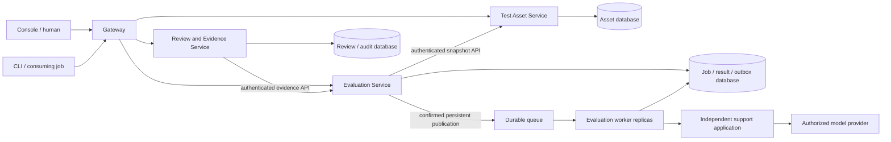

# ReleaseGuard implementation architecture

Status: working implementation baseline under local verification. Cloud architecture is a deployment target until hosted evidence is retained.

## Logical services and data ownership



Three business services own distinct databases and logins. Evaluation workers are replicas inside one bounded context, not a fourth database-owning business service. Gateway/support components have no business database access. The repository and image initially share libraries; process role selects the service. Each Kubernetes Deployment or Compose service is separately deployable/scalable. Service-specific build contexts can be separated later if team delivery requires it.

## Representative distributed workflow

```mermaid
sequenceDiagram
  participant C as Console / CLI
  participant E as Evaluation API
  participant R as Asset API
  participant D as Evaluation DB
  participant Q as RabbitMQ
  participant W as Worker
  participant A as Support app
  participant V as Review API
  C->>E: Candidate + suite ID + idempotency key
  E->>R: Get tenant-scoped immutable snapshot
  R-->>E: Application and suite
  E->>D: Transaction: job + outbox
  E-->>C: 202 queued + job ID
  E->>Q: Persistent message; wait for confirm
  E->>D: Mark outbox sent
  Q->>W: Manual-ack delivery
  W->>D: Conditional claim + expiring lease
  W->>A: Execute fixed cases (real or labelled replay)
  A-->>W: Outputs, errors and provenance
  W->>W: Deterministic rules and gate
  W->>D: Conditional final evidence commit
  W->>Q: Consumer acknowledgement
  C->>V: Request review
  V->>E: Get completed passing evidence
  V->>V: Persist review snapshot + audit
  C->>V: Different human: versioned decision
  V->>V: Transaction: one terminal decision + audit
```

## State and consistency

- Suite versions append; previous IDs/snapshots remain valid. Two branches may share a display version number, so integrations use IDs.
- Jobs: queued → running → succeeded or failed. `succeeded` means execution finished; `result.gate` can still be blocked. Missing output, execution error, latency evidence required by policy, or critical failure blocks the gate.
- Outbox and job are committed together; a crash between broker confirmation and the `sent_at` commit can produce duplicate delivery. Database lease claims and conditional final writes protect final evidence. There is no exactly-once distributed transaction.
- Worker heartbeat extends the lease. A sweep finds expired running jobs, returns them to queued and inserts a new outbox event atomically. Maximum three claimed attempts; the next claim records terminal failure. Restart does not regenerate suite versions or erase committed evidence.
- Reviews: only a completed passing job can create one request; pending → approved/rejected once. A row lock serializes decisions; expected version rejects stale requests. Both creator and requester are excluded from reviewing. Service identities cannot review, including in replay mode.
- Review service copies immutable evaluation evidence through an API. Foreign keys remain local to each database. Availability failure of Evaluation API blocks a new review request; already captured evidence remains reviewable.

## Architecture decisions

1. Microservice-oriented deployment replaces the earlier single Worker to match lecturer guidance and expose independently scalable execution. Cost: more failure modes and operational components.
2. Three business boundaries follow assets, execution and human decisions; frontend/backend layers and member names are not used as service boundaries.
3. Durable queue decouples admission and execution; outbox removes the unprotected database-write/queue-publish gap. Cost: delayed starts and duplicate deliveries.
4. One database per service with separate non-superuser accounts prevents direct cross-service data access. Local PostgreSQL infrastructure is shared; this is not independent database HA.
5. Immutable suite/evidence snapshots prioritize historical reproducibility over storage economy. Content hashes aid comparison, not cryptographic provenance.
6. Fail-closed gates and independent human review preserve accountability. Rules are five bounded predicates, not semantic quality certification.
7. Separate real/replay/imported provenance. Replay is for local demonstrations and controlled capacity work; there is no synthetic fallback for provider failures.
8. Manual replica experiments precede automatic scaling. KEDA is appropriate for queue depth; CPU HPA alone can miss I/O-bound provider workloads.
9. Cloud identity uses trusted OIDC JWTs and explicit custom workspace/role claims. Local signed demo tokens are an intentionally different, loopback-only test identity setup.
10. Minimum course delivery omits service mesh, a general AI judge, billing and multi-region disaster recovery. Three services plus workers must be complete before optional features.

## Physical target and trust boundaries

Cloud HTTPS ingress → gateway → cluster-internal services → separate databases / broker. A trusted OIDC issuer signs human tokens; services validate issuer, audience, signature and expiry. An issuer-managed `workspace`, `role`, `service` claim contract is required; service identities also require an issuer-bound human `principal` so a machine submission cannot bypass the owner's independent-review obligation. Access is not inferred from untrusted request headers. Cloud JWKS must be HTTPS. Internal requests use distinct short-lived audience-bound tokens and private service endpoints; cluster traffic TLS/service-specific keys are an additional hardening step if required by deployment policy.

External model access is HTTPS with server-side credentials. The support app runner origin is allowlisted, redirects are rejected, and response/payload/case limits apply. Gateway is the only local published port, bound to loopback. DB/broker are not publicly exposed.

Evaluation admission is limited to 1,000 new jobs per workspace/accountable principal/minute by default. Same-key retries replay without new admission. Configure a lower cloud cap before paid experiments; the independent real runner additionally requires explicit enablement and limits each execution to ten cases. This is not an account-wide monetary budget controller. Suite/application admission controls and JWT revocation/introspection are further cloud operating concerns; local tokens expire after one hour.

Local containers specify resource limits, unprivileged Node user, read-only root filesystems and dropped capabilities. Kubernetes files use equivalent policies and probes. Database/broker HA, managed backup/restore, TLS ingress and OIDC setup must be configured and verified on the selected cloud platform.

## Limits to report

No hosted CI/CD, real-provider experiment, cloud autoscaling, cloud throughput, SLA or restore drill is established by local tests. Shared-host replica comparisons may show little/no gain for inexpensive predicates; report that finding rather than add artificial delay. Provider quota is shared across workers. At-least-once recovery can repeat external requests. A lease heartbeat cannot guarantee cancellation of an already issued model request. Initial application database migrations run at service startup; production schema evolution needs explicit versioned migration jobs before destructive changes. Individual contribution and project effort require human records.
