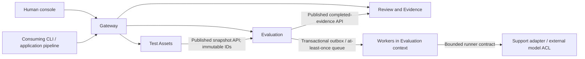

# Domain-driven design — Team 13

Design revision: 11 October 2026. This is an AI-assisted design analysis for team review, not a claim that a team event-storming workshop has already occurred. B owns boundary decisions; all five members must be able to explain the representative workflow. The approved proposal stays unchanged.

## 1. Problem and ubiquitous language

ReleaseGuard helps an application team decide whether a candidate change has sufficient evaluation evidence for **independent human release review**. It is not a GitHub replacement, training platform, automatic deployment authority or guarantee of semantic safety.

| Term | Meaning and invariant |
|---|---|
| Application | Registered consumer/runner and allowlisted endpoint, scoped to a workspace. |
| Suite version | Immutable ID containing cases and gate policy. Version numbers are display labels; separate branches may share a number. |
| Candidate | Application/prompt change identified by a caller-supplied commit reference. The platform does not attest that this reference is a real Git commit. |
| Evaluation job | One accepted request plus its asset snapshot, attempts, results and provenance. Idempotency belongs to the workspace/key pair. |
| Execution succeeded | Worker finished evaluating; does **not** mean rules passed. |
| Rule eligible | Score/policy passed, no missing evidence/errors/critical failures; does **not** mean approved. |
| Release request | Frozen passing evidence awaiting a different human's decision. Approval is a record, not deployment. |
| Replay / imported / real | Fixed demonstration answers / caller-supplied answers / actual authorized provider execution. These cannot be relabelled interchangeably. |

## 2. Subdomains and bounded contexts

The core domain is evidence-backed release assurance (Evaluation and Review). Test Asset management is supporting. Identity, broker, runtime and deployment are generic capabilities. The support app is a separate consuming application/adapter, not part of the assurance platform's domain data.

| Context | Aggregate roots and owned data | Commands / invariants | Why its own boundary |
|---|---|---|---|
| Test Assets (`registry`) | Application; SuiteVersion; `rg_registry` | RegisterApplication, CreateSuiteVersion. Tenant-scoped references, unique case IDs, immutable suite IDs, runner allowlist. | Asset authoring changes independently of execution; execution copies a stable snapshot rather than sharing tables. |
| Evaluation (`evaluation` + `worker`) | EvaluationJob; job/result/lease/outbox; `rg_evaluation` | SubmitEvaluation, ClaimJob, CompleteJob, RecoverLease. Job + outbox atomic, no duplicate terminal write, missing evidence blocks. Replay/imported jobs allow up to three execution attempts. A real job allows one execution attempt; lease recovery fails it instead of calling the provider again. | Bursty/slow runner work needs a queue and independently scalable executors. Worker is part of this context, not a new business service. |
| Review & Evidence (`governance`) | ReleaseRequest with decision version and audit; `rg_governance` | RequestReview, DecideReview. Passing snapshot required, creator/requester excluded, machines excluded, one terminal decision + audit in one transaction. | Human decision lifecycle and historical retention remain available after upstream execution outage. |

An aggregate is a **transactional consistency boundary**, not one service per table or one service per member. The monorepo and common image are delivery choices; independent processes and data ownership implement the service boundaries. Shared database infrastructure is still a local single point of failure.

## 3. Context map and integration contracts

- Assets is upstream to Evaluation. Its published snapshot API is consumed as a read-only contract; Evaluation stores the response. No cross-context join or foreign key.
- Evaluation is upstream to Review. Review validates eligibility and copies complete evidence at request time. Later decisions use that local snapshot, not an upstream live query.
- The model adapter is an anti-corruption layer: provider-specific HTTPS responses become bounded outputs/errors/provenance. An error is not translated to a fabricated passing answer.
- The queue message is a transport work notification containing job ID, **not** the authoritative result. Workers obtain the authoritative record from their own context's database.
- Current `ReleaseRequested/Approved/Rejected` records are persisted domain audit events, not publicly subscribed integration events. Do not claim an event bus for those records.
- Internal calls are authenticated and audience-scoped; shared local signing material is a practical baseline, not zero-trust isolation from a compromised internal service.

## 4. Representative command / event / policy analysis

| Step | Actor / command | State or event | Policy and failure behavior |
|---|---|---|---|
| 1 | Contributor: SubmitEvaluation | Job queued + outbox committed | If Asset API unavailable, reject new admission. Reusing a committed key returns the existing job without an Asset lookup. |
| 2 | Publisher: publish work | Broker-confirmed persistent message | Crash after confirm may duplicate delivery. No exactly-once claim. |
| 3 | Worker: ClaimJob | Running lease + attempt | Conditional claim and heartbeat. Replay/imported execution permits three attempts; real execution permits one, after which recovery marks failure without another runner call. Stale workers cannot overwrite another lease's result. |
| 4 | Runner + rules: CompleteJob | Succeeded with passed/blocked gate, or failed execution | Five general predicates plus versioned `returns_policy_v2` / `returns_policy_v2_1` checks; these are bounded rules, not an AI judge. Provider quota limits real throughput. |
| 5 | Contributor: RequestReview | ReleaseRequested + frozen evidence | Only a completed passing job. Upstream unavailable means no new snapshot. |
| 6 | Independent reviewer: DecideReview | ReleaseApproved OR ReleaseRejected | Locked row + expected version + aggregate policy. Audit and decision commit together. Captured evidence remains usable during Evaluation outage. |

The pure aggregate transition is implemented in `src/contexts/review.ts`, invoked inside the locked transaction in `src/governance.ts`. HTTP identity/authorization stays in the application layer; database operations stay in the transaction adapter. `tests/review.test.ts` checks both decisions, stale versions, self-review and terminal states. `scripts/verify-contracts.mjs` verifies the cross-service consequences against real local HTTP and databases, including upstream outages.

## 5. Decisions and alternatives

1. **Reject a modular monolith as the course target.** It would reduce deployment overhead but not satisfy the lecturer's requested microservice-oriented, horizontally scalable target.
2. **Choose three contexts, not six arbitrary microservices.** Splitting every table/role would add distributed transactions without a demonstrated business boundary. Splitting Review from Evaluation does isolate human workflow and captured evidence availability.
3. **Keep worker and Evaluation in one context.** They share aggregate ownership legitimately. Workers scale separately but must deploy schema-compatible versions.
4. **Copy immutable evidence rather than synchronous decision-time orchestration.** More storage, but stable audit and independent review availability. This is not multi-service ACID.
5. **Use queue-driven cloud autoscaling, not CPU alone.** Provider I/O can leave CPU low while work accumulates. The original design treated KEDA as a target. Subsequent team cloud experiments are documented in `docs/10-Cloud-Acceptance-20261011.md`; those are historical results, not a new cloud verification in this review.
6. **Keep shared image initially.** Independent process replicas are real; per-context build/release isolation is incomplete. Record this coupling honestly rather than call the baseline fully autonomous microservices.

## 6. Questions for the team, not fabricated decisions

- B/A: confirm retention, who may author a suite, and whether a release request can ever be superseded (current terminal decisions cannot reopen).
- C: choose authorized provider/model and real support policy; have a different member complete the human rubric.
- D/E: validate managed DB/broker availability, OIDC claim mapping, queue trigger threshold, cold-start delay, min/max workers and cost cap on the selected cloud.
- All: review alternatives and commit actual rationale/changes through individual PRs. Record actual date, participants and effort, not generated meeting history.

References: [Bounded Context](https://martinfowler.com/bliki/BoundedContext.html), [Domain-driven Design](https://martinfowler.com/bliki/DomainDrivenDesign.html), [Microservices](https://www.martinfowler.com/articles/microservices.html). These inform terminology; the service split above is our project-specific design judgement.
