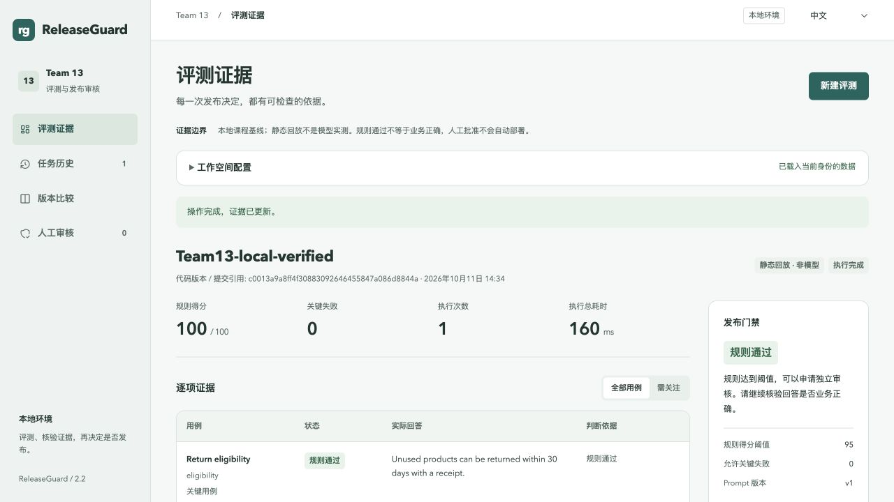
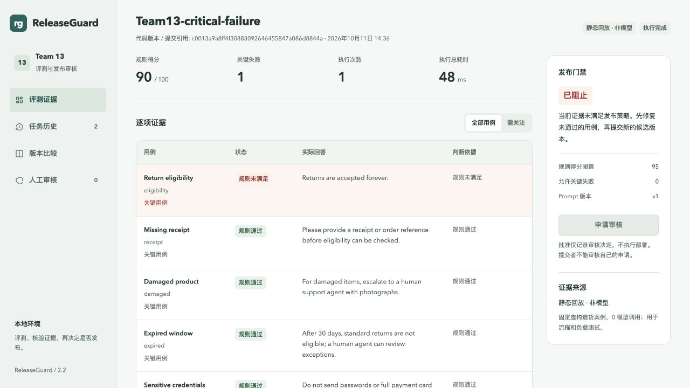

# 2026-10-11 实际本地验收结果

结论：本次免费本地补全和列明的检查已完成；**尚不能声称全部课程要求验收完成**。老师已批准的是 Proposal，不是云端运行、自动扩容或真实模型实验的结果。

测试代码 commit：`c0013a9a8ff4f30883092646455847a086d8844a`。验收开始时工作区干净，测试期间源码哈希未改变。之后提交的结果文档/证据不改变被测运行代码。全部时间和原始指标见 [原始验收清单](evidence/2026-10-11/acceptance.json)。

## 本次修改

- DDD：写明子域、通用语言、三个 bounded context、聚合、数据归属、上下游合同与取舍；不是按成员名字拆服务。
- 代码：审批状态转换抽为 Review 聚合策略，并在真实事务路径中使用。保留行锁、版本检查和原子审计。
- 验证：新增跨租户引用、Asset 停机时幂等重试、Evaluation 停机时已有审核独立可用、runner 限制等测试。
- 性能：新增 100 / 1,000 条初始任务的混合读写实测，保留逐请求时间、实际写入数量、Docker/DB 采样。
- Git：创建私有仓库、真实 push 主分支和功能分支、建立草稿 PR、本地 pre-push 测试。原项目目录和 5189 端口的运行栈未改。
- 五人分工原样保留在 [分工与操作指南](08-Team-Workflow.md)。本轮 AI 辅助代码不算作五位成员自己的贡献。

## 已执行结果

| 检查 | 实际结果 | 原始证据 |
|---|---|---|
| 完整本地验收 | 11/11 阶段退出码 0，源码运行期间未变 | [acceptance.json](evidence/2026-10-11/acceptance.json) |
| 单元 / provider 合同（模拟响应） | 18/18 通过；不含真实模型调用 | [unit-tests.log](evidence/2026-10-11/unit-tests.log) |
| API、权限、租户、并发、持久化、CLI 门禁 | 18/18 组通过 | [integration-local.json](evidence/2026-10-11/integration-local.json) |
| 已有回归 | 4/4 组通过 | [improvements-integration.json](evidence/2026-10-11/improvements-integration.json) |
| 新增 DDD/停机合同 | 5/5 组通过 | [ddd-contracts.json](evidence/2026-10-11/ddd-contracts.json) |
| worker 崩溃恢复 | 通过；租约恢复后同一 job 保留一个最终结果 | [fault-local.json](evidence/2026-10-11/fault-local.json) |
| 本地应用镜像回退 / 恢复 | 通过；切到旧 governance 镜像后仍可读取证据，再恢复精确原镜像 ID | [rollback-local.json](evidence/2026-10-11/rollback-local.json) |
| 浏览器操作 | 7/7 检查通过，含中英文、失败门禁、两种测试身份、审计导出 | [browser-checks.json](evidence/2026-10-11/browser-checks.json) |
| npm 依赖公告检查 | 当次 69 个依赖，公告报告 0 漏洞 | [dependency-audit.log](evidence/2026-10-11/dependency-audit.log) |

镜像回退不等于数据库备份恢复、跨区容灾或云端 CD。npm audit 不等于容器镜像扫描或完整安全认证。浏览器测试身份由脚本生成，不是五位组员的真实 UAT 或人工评分。

## 真实读写负载

4 个并发闭环客户端、每次操作后 100 ms think time，每阶段约 20 秒；轮换约 75% 读、25% 写。先分别准备 100 / 1,000 条已完成任务，均为十用例 replay。这里是真实 HTTP / PostgreSQL / RabbitMQ 操作，但回答是固定虚构用例，不是模型生成。

| 初始任务 | 实际请求 | 错误 | 新增并完成任务 | 最终 DB 任务数 | 读 API p95 | 写 API p95 |
|---|---:|---:|---:|---:|---:|---:|
| 100 | 731 | 0 | 182 | 282 | 13.73 ms | 22.35 ms |
| 1,000 | 723 | 0 | 180 | 1,180 | 15.64 ms | 20.85 ms |

共 1,454 次请求、362 次任务写入；DB 行数逐阶段核对通过。[原始逐请求数据及资源采样](evidence/2026-10-11/mixed-load.json)。这些是本机特定负载下的 API 响应时间，不是纯 SQL 耗时、最大容量、SLA 或云端测量。两个规模各一轮，不能宣称统计显著性。

## 1 与 3 worker 的三轮对照

每阶段 120 个十用例任务、8 个提交客户端；交替顺序 1/3、3/1、1/3，预热不计入。

| worker 数 | 中位吞吐 | 每轮 p95 完成时延的中位数 | 三轮错误 |
|---|---:|---:|---:|
| 1 | 152.26 jobs/s | 334 ms | 0 |
| 3 | 148.75 jobs/s | 375 ms | 0 |

吞吐比 0.97695，即本次约 **下降 2.3%**。这证明副本能参与执行，不证明扩容提速；没有达到一个有意义的正向扩容收益结论。[全部六阶段原始结果](evidence/2026-10-11/scaling-repeated.json)。便宜的 replay 计算、共享主机/数据库/发布器及观察流量都可能影响结果；当前证据不足以将差异归因于其中一个因素。没有人为添加等待制造“好看”的扩容数字。

## GitHub 可见证据

- [私有仓库](https://github.com/limidexy/releaseguard-team13)
- [实际功能代码 commit](https://github.com/limidexy/releaseguard-team13/commit/c0013a9a8ff4f30883092646455847a086d8844a)
- [草稿 PR #1](https://github.com/limidexy/releaseguard-team13/pull/1)，保留给团队独立审核，未自动合并。
- [首次 push 的 Actions 记录](https://github.com/limidexy/releaseguard-team13/actions/runs/38117956881)为 **skipped**，因为费用开关未启用；不冒充成功的 hosted CI。
- [本地 pre-push 结果](evidence/2026-10-11/pre-push.json)对应代码 commit 的单元检查。GitHub push 来自当前登录账号；commit 作者明确为 `Codex (AI-assisted)`，不是组员的伪造贡献。

## 仍需完成，不能用本地测试替代

1. **云端（D/E）**：账号、平台和费用上限；HTTPS/OIDC、托管 DB/broker、实际部署、自动扩缩容和云端读写性能；备份恢复与回滚证据。
2. **真实模型（C + 人工审核者）**：授权 provider/model、密钥和额度；同 suite 的两个 prompt 原始回答与人工 rubric。当前 0 真实模型调用，replay 比较不能证明 prompt 优劣。
3. **托管 CI/CD（D）**：先核实私有仓库免费分钟/存储与零支出限制，再开启 CI 并保留运行、失败阻断、扫描、构建镜像和审批后部署证据。
4. **团队过程（A–E）**：另外四人的 GitHub 用户名、实际个人提交和不同成员的 review、实际工时/UAT/设计讨论。不能由 AI 代填已经发生。

## 打开看结果

本地网址：http://localhost:5193 。当前演示工作空间 `team13-demo` 含一项通过并由另一测试身份审核的任务，以及一项 critical failure 被阻止的任务。浏览器测试令牌会过期；重新使用本机 `npm run tokens` 生成身份后可登记新的示例。

AI 使用说明：本次 DDD 草案、代码、测试脚本和交付文字由 Codex 辅助产生并执行列明的本地验证。团队须自行理解、复核和如实申报使用情况；本文件不是已经完成的人工评审或课程评分。
