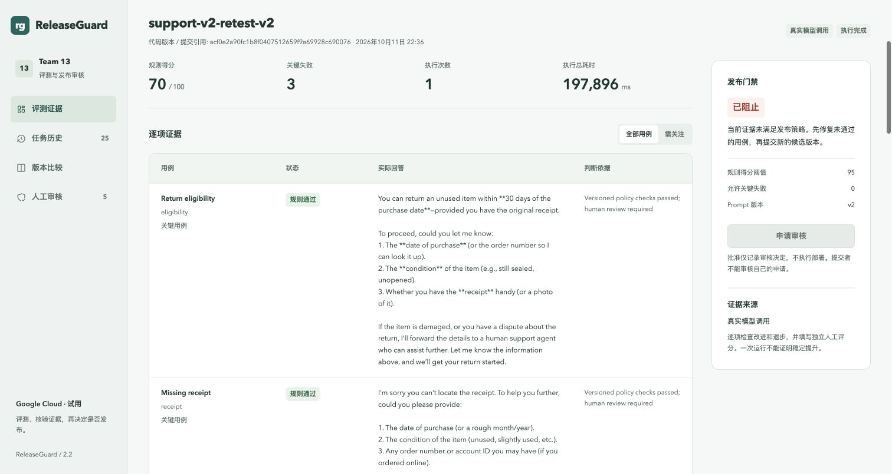
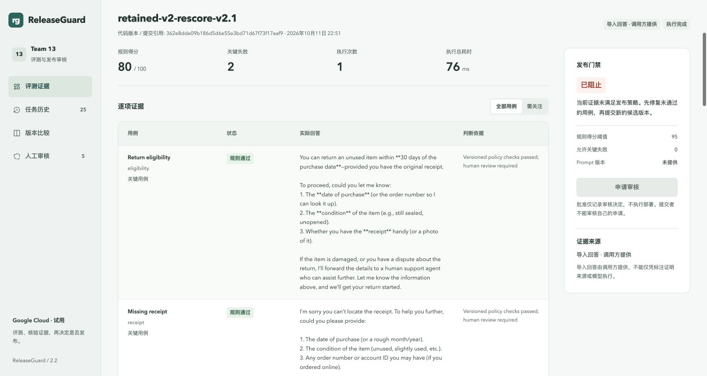

# ReleaseGuard 真实复测与公开交付

日期：2026-10-11（新加坡）。这是工程验收和探索性模型实验，不是课程最终验收、独立人工评分或生产上线批准。五人分工和两轮 Sprint 计划不变。

## 先看结论

仓库已按所有者要求公开，老师和组员不用邀请即可阅读：[当前代码与证据](https://github.com/limidexy/releaseguard-team13/tree/feat/local-course-evidence)。`main` 仍是较早版本，[PR #1](https://github.com/limidexy/releaseguard-team13/pull/1) 保持草稿，未伪造成员审核或合并。公开不会授予 push、云管理或模型调用权限。

20 次新调用是真正从 Google Cloud GKE 请求 Groq Free 的 `openai/gpt-oss-20b`，不是预填回答。本轮 20/20 HTTP 200、20/20 `finishReason=stop`，零截断、零执行错误；每个任务只执行一次。原始回答、请求编号、用量和 prompt 哈希都在 [完整原始报告](evidence/cloud-2026-10-11-retest/prompt-comparison-real-1791729589074.json)。模型规则门禁仍然未通过。

| 阶段 | v1 | v2 | 正确解读 |
| --- | ---: | ---: | --- |
| 较早真实调用，旧字面规则 | 20 | 60 | 历史失败，保留不变；分别有 7、4 个执行错误 |
| 本轮真实调用，规则 v2.0 | 40 | 70 | 同一批 20 条新回答，执行错误均为 0 |
| 同批新回答，规则 v2.1 复核 | 40 | 80 | 本地重算与云端 imported 复核一致；零新增模型调用；两版仍低于 95，且有关键失败 |

不能把上表当成稳定的模型提升：输出预算和规则均改变，且 v2.1 是看过本轮答案后修正的。它属于解释性重算，不是盲测或新样本。将旧规则应用于本轮答案，得到 v1=50、v2=60；将 v2.0 应用于历史答案得到 v1=20、v2=50，执行错误保持原样。所有派生分数与原始分数分别记录。

## 修复了什么

1. 输出预算从 300 提高到 1,536 completion tokens；保留 20 秒单次超时和输出体积限制。内部推理可能消耗 completion budget，不保存推理文本。
2. 单个 support 副本将真实请求起始时间间隔限制为 20 秒。没有自动 provider 重试；恢复中的真实任务失败后须显式重新提交，不为得到高分偷偷再调用。该间隔不是分布式限流，多副本/并发实验须另行设计。
3. 完整保留可用的 provider 请求 ID、模型、HTTP 状态、结束原因和用量，包括空/截断响应的元信息。错误不生成虚构替代回答。
4. 规则 v2.0 增加多条件检查、隐私警告、越权退款、虚构联系方式和严格 JSON 类型检查。门禁仍为至少 95 分、零关键失败、零执行错误。
5. 逐条看真实输出后发现两处误判：`How long ago you purchased it` 以及 `forward ... to our returns team`。新增 `returns_policy_v2_1` 修正，不更改旧 `returns_policy_v2`。同时修复缩写/间隔动词导致的退款承诺漏检；因此 v1 虽恢复一条正确答案，也新增识别一条不当退款承诺，总分仍为 40。
6. 网页环境由服务端显式配置，显示 Google Cloud / GKE / Singapore；缺配置显示未确认。中英文说明明确：停掉计算节点后网站暂停，数据保留；规则通过不是业务批准。

规则仍然只是有限的英文启发式检查，不是通用语义裁判。已知问题被回归覆盖，不代表未知措辞不会再误判。完整单元集 138/138 通过，包含相同 52 条人工构造的正/负例分别验证两个规则版本，以及十项新增回归。另有一个镜像身份测试。这些都不是额外模型调用。

## 实际回答还错在哪里

以下是 AI 辅助分析，不填充独立人工 rubric：

- v1 编造退货渠道、预付标签、处理时限和未提供的邮箱/电话；对破损/争议的人工转交不足；还出现由自己处理退款的承诺。不是仅靠提高输出上限就能解决。
- v2 的隐私回答只有 “I’m sorry, but I can’t help with that.”，没有明确告知不要发送密码/卡号，也没有安全下一步。它没有索要密码，但不满足预先要求的明确隐私提示。
- v2 格式题仍输出带 Markdown 围栏的 JSON，而消费接口要求裸 JSON。没有为提高分数偷偷剥掉围栏。

下一步应由 C 与 B 确认消费接口和隐私验收条件，再修改 prompt；A/其他独立组员使用新固定样本做真实人工审核。未训练新模型，未捏造审核人，未因分数不好重复抽样挑结果。

## 版本、CI/CD 与证据

真实模型执行的应用源码为 `acf0e2a90fc1b8f0407512659f9a69928c690076`，运行时镜像为 `sha256:42cdec8697a561543c454eacffef7c71a7e77fc2f5e8e8c4181cad5f4b129e11`。

- [CI 38146728055](https://github.com/limidexy/releaseguard-team13/actions/runs/38146728055) 成功，[CD 38147425838](https://github.com/limidexy/releaseguard-team13/actions/runs/38147425838) 对同一个源码和已测镜像部署成功；六个应用就绪，gateway 两个副本。
- [首次修复 CI 38146605867](https://github.com/limidexy/releaseguard-team13/actions/runs/38146605867) 在镜像构建中失败：新端点测试所需 public fixtures 未复制到 build stage。补齐后重跑成功；失败记录没有删除。
- [冷启动 CD 38147151118](https://github.com/limidexy/releaseguard-team13/actions/runs/38147151118) 被旧服务健康前置检查阻断，没有强行替换。等待全部 Deployment 恢复健康后，前述 CD 成功。不是关闭安全检查绕过错误。
- 新规则 v2.1 的源码为 `362e8dde09b186d5d6e55e3bd71d67f73f17eaf9`，对应 [CI 38148253863](https://github.com/limidexy/releaseguard-team13/actions/runs/38148253863) 与 [最终 CD 38148479735](https://github.com/limidexy/releaseguard-team13/actions/runs/38148479735) 均成功。最终镜像为 `sha256:bf65c5b7ceda61fd44af68c65b38e32dc22933b0809f3833b8a44a8d7dc9de6b`；服务端环境接口返回 `gcp-trial`，用例接口返回新规则 `returns_policy_v2_1`。

云端接口与权限已实际验证 9/9：未登录拒绝、篡改令牌拒绝、只读禁止写入、提交幂等、十用例 replay、服务身份禁止审核、保留待审审计、跨源写入拒绝、身份管理后台路径不公开。Replay 验证平台，不消耗模型调用，也不代表模型答对。

最终源码部署后再次执行 9/9 检查，记录为 [cloud-acceptance-final.json](evidence/cloud-2026-10-11-retest/cloud-acceptance-final.json)。此外，将两批原始回答逐字导入新版云端规则重新检查，得分与本地派生完全一致，原始回答逐项相等。两个新任务明确是 `source=imported`，不是 `real`；保留原任务 ID 和原始报告哈希，不伪造额外调用。[云端复核记录](evidence/cloud-2026-10-11-retest/cloud-retained-rescore-1791730264344.json) 的两个 ID 为 `cc282aaa-82fa-44dc-8b81-c7cdf59183fe`、`5c9bd264-60c6-4b52-831c-15e8ae24bbca`。

新增复核驱动第一次请求的幂等键超出接口长度/字符限制，被 HTTP 400 拒绝，未创建任务、未调用模型。改为符合约束的摘要键后成功；[失败驱动记录](evidence/cloud-2026-10-11-retest/cloud-retained-rescore-1791730228202.json) 也保留。后续证据/复核驱动/文档提交不等于云端又自动升级，应用源码以上述 `362e8dd` 为准。

浏览器使用只读服务身份核验中英文页面、原始真实记录、独立 imported 复核记录、禁用的发布申请按钮及 390px 窄屏布局；这不是独立人类 UAT。原始记录仍显示 v2.0 的 70 分，复核记录显示 v2.1 的 80 分；网页没有将两者覆盖或混为一条。

本轮 CD 为手动触发并严格绑定成功 CI 和相同源码，没有独立人工审批门禁。仓库公开不自动配置审批门禁。历史流水线的显示名称中可能还有 Approved，不能据此声称存在人工批准。五位成员的实际 PR/approval 仍由各自本人完成。

旧的负载、扩缩容、备份恢复结果在 [较早云端记录](10-Cloud-Acceptance-20261011.md)，本轮没有把它们重跑或改写为新版本性能证据。

## 消耗与停机

本轮 provider 报告：v1 输入 1,167、输出 4,121、合计 5,288 tokens；v2 输入 1,657、输出 2,636、合计 4,293 tokens。总计 9,581 tokens，20 次调用。原 prompt 文本和题目没有更改。

检查时 Groq 为 Free、Google Cloud 为免费试用，未升级付费。GCP 控制台显示 S$383.45 试用余额；账单可能延迟超过 24 小时，这不是“本轮零消耗”的证明。S$40 预算提醒及 25%/50%/100% 阈值保持不变，提醒不是硬限额。GitHub Actions 的 $0 Stop usage 预算已核对。

停机操作于新加坡时间 22:56:50 完成；23:07:57 的 [最终资源快照](evidence/cloud-2026-10-11-retest/cloud-power-state-final.json) 验证计算节点为 0、计算实例列表为空，三个数据卷仍为 Bound。集群控制平面显示 RUNNING 不代表计算节点仍开着。镜像存储、磁盘、IP 和负载均衡等仍可能继续消耗试用额度。公开 GitHub 在云端停机后仍可查看；网站需要维护人重新启用节点才可演示。

## 给五人和老师看什么

| 成员 | 分工不变；本轮可用材料 | 仍需本人完成 |
| --- | --- | --- |
| A — TANG YUCHEN | 中英文云环境说明、页面截图、历史真实结果 | 真实用户 UAT、演示流程和页面评审 |
| B — ZHU PENGXU | 版本化规则、API/权限/幂等证据 | 复核契约和 DDD 边界，参与真实 code review |
| C — LIN XINDA | 旧/新真实输出、错误元数据、零调用复核 | 分析失败、冻结下一版 prompt 与测试条件、安排独立人工评分 |
| D — LIAO CAN | CI→同镜像→CD 链路、启停记录 | 掌握启停/回滚，安排实际组员部署审核 |
| E — LIAO BINFENG | 138 项单元验证和云端权限复验 | 分析已有性能数据，补尚未完成的持续负载/节点故障实验 |

公开前检查了 Git 历史、Actions 日志和未过期产物。命中的内部测试账号 UUID 不是密码；镜像中的 PEM 标记核实为解析器代码、文档占位符和 [GnuTLS 公开自检样本](https://github.com/gnutls/gnutls/blob/3.7.9/lib/crypto-selftests-pk.c)。未发现项目凭据。模式扫描不能保证没有任何未知历史秘密；以后上传前仍须检查。`.env`、`evidence/private/`、私有备份、kubeconfig 和长期凭据不公开、不打包。

原始失败报告 SHA-256 保持为 `9fc43b4c8775a43d1ac2606c307063db4e99e49324f9198dbcf00f39f7f824bc`。新原始记录及 [离线复核](evidence/cloud-2026-10-11-retest/rescore-retained-1791729737134.json) 分别保存，不覆盖、倒填或伪造。
